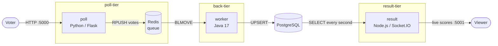

# Popeye: Containerized Voting App with a Message Queue

A distributed voting application made of five containers orchestrated with Docker Compose. Votes are sent asynchronously through a Redis queue, processed by a Java worker, stored in PostgreSQL and streamed live to a results page.

Built for the Epitech DevOps module (*Popeye*). The project focuses on containerization, service isolation and reliable asynchronous processing.

## Architecture



| Service | Stack | Role | Networks |
|---|---|---|---|
| `poll` | Python 3.12, Flask, gunicorn | Voting page; pushes each vote to the Redis queue | poll-tier |
| `redis` | Redis 7.4 | Message queue between `poll` and `worker` | poll-tier, back-tier |
| `worker` | Java 17, Jedis, JDBC | Consumes the queue and stores votes in PostgreSQL | back-tier |
| `db` | PostgreSQL 14 | Persists one vote per voter | back-tier, result-tier |
| `result` | Node.js 22, Express, Socket.IO | Pushes live percentages to the browser | result-tier |

The three networks isolate the tiers: the voting front-end can reach Redis but not the database, and the results page can reach the database but not the queue. Only `poll` and `result` publish ports on the host.

## Reliable message processing

The worker does not simply pop votes off the queue. A plain `BLPOP` removes the message before it is stored, so a crash at the wrong moment loses the vote. Instead:

1. `BLMOVE` atomically moves the vote from `votes` to a `votes:processing` list.
2. The worker writes it to PostgreSQL with an upsert (`INSERT ... ON CONFLICT DO UPDATE`), so a voter who changes their mind keeps a single row and a replayed message is harmless.
3. Only then is the vote removed from `votes:processing`.
4. At startup, the worker moves anything left in `votes:processing` back to the front of the queue.

This gives at-least-once delivery. Malformed messages are logged and dropped instead of crashing the worker.

## Getting started

**Requirements:** Docker with the Compose plugin. Ports 5000 and 5001 must be free.

```bash
git clone https://github.com/alir961/popeye.git
cd popeye
cp .env.example .env          # optional: set your own database credentials
docker compose up --build -d --wait
```

| URL | Page |
|---|---|
| http://localhost:5000 | Vote |
| http://localhost:5001 | Live results |

Stop the stack with `docker compose down`, or `docker compose down -v` to also delete the database volume.

## Configuration

| Variable | Used by | Default |
|---|---|---|
| `POSTGRES_USER`, `POSTGRES_PASSWORD`, `POSTGRES_DB` | `db`, `worker`, `result` | `postgres`, `password`, `postgres` |
| `REDIS_HOST` | `poll`, `worker` | `redis` (set by Compose) |
| `DB_HOST` | `worker`, `result` | `db` (set by Compose) |
| `OPTION_A` to `OPTION_D` | `poll` | Ansible, Chef, Puppet, SaltStack |

Compose reads the database credentials from `.env`. Change the default password before running the stack anywhere but your own machine.

## Checking that it works

```bash
# Cast a vote, then read it back from the database
curl -X POST -d vote=a http://localhost:5000/
docker compose exec db psql -U postgres -c "SELECT vote, COUNT(*) FROM votes GROUP BY vote"

# Follow the worker
docker compose logs -f worker

# Crash recovery: kill the worker, leave a vote in the processing list, restart it
docker compose kill worker
docker compose exec redis redis-cli rpush votes:processing '{"voter_id":"test","vote":"c"}'
docker compose start worker   # logs "Requeued 1 unfinished vote(s)" and stores the vote
```

## Container images

- Every image runs as a non-root user and listens on port 8080 inside the container.
- The worker uses a multi-stage build: Maven compiles a single JAR, and only a JRE image ships it. Dependencies are resolved in their own layer, so they are cached between code changes.
- `result` installs its dependencies from `package-lock.json` with `npm ci`.
- Each service has a `.dockerignore` so build contexts stay small.

## Project structure

```
.
├── docker-compose.yml     services, networks, healthchecks, volume
├── schema.sql             votes table, loaded by PostgreSQL at first start
├── .env.example           database credentials template
├── poll/                  Flask app, template and stylesheet
├── worker/                Java worker (Maven)
└── result/                Node.js server and AngularJS results page
```

## Credits

The application code comes from Docker's [example-voting-app](https://github.com/dockersamples/example-voting-app), which the Epitech subject provides as the starting point. My work covers the containerization and orchestration (Dockerfiles, Compose stack, network isolation, healthchecks, configuration), the fixes needed to run it, the upgrade of every service to current runtimes and libraries, and the reliable processing in the worker.
